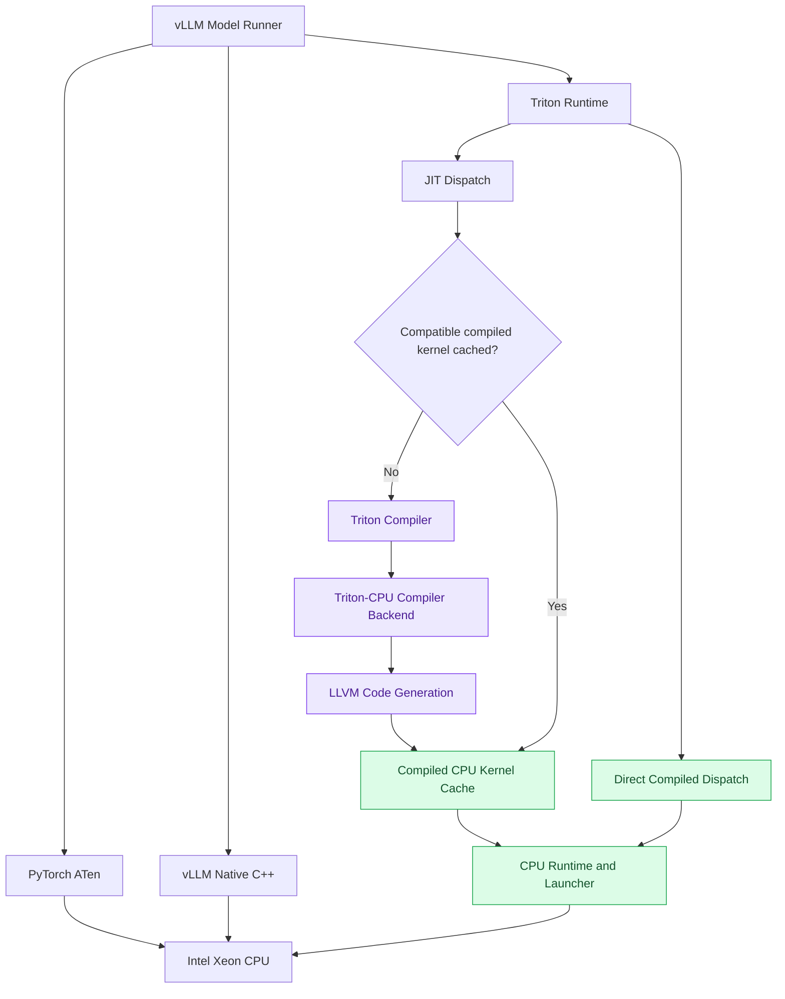
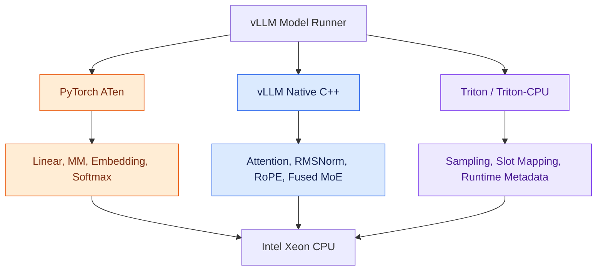
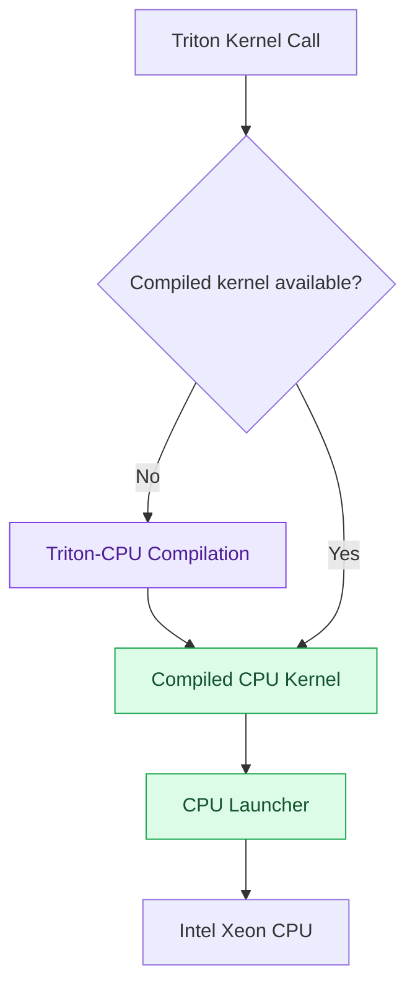

# vLLM CPU Kernel Architecture on Intel Xeon

## 1. Architecture overview

vLLM orchestrates inference and uses three principal kernel implementation paths: PyTorch ATen CPU operators, vLLM native C++ operators, and Triton kernels targeting the CPU through Triton-CPU. These are implementation paths, not mutually exclusive dispatch systems: vLLM custom C++ operators can be registered through PyTorch's dispatcher.

The direct dispatch path assumes a compatible compiled kernel handle has already been obtained. The cache represents both in-process reuse and persistent compiler artifacts at a conceptual level. Compiler stages and launch interfaces vary by version. PyTorch Inductor is omitted for clarity.

## 2. Representative kernel paths

### PyTorch ATen CPU operators

Representative operators; actual dispatch depends on model, datatype, build and configuration.

| Operator | Function | Typical LLM usage |
|---|---|---|
| `aten::linear` | Linear transformation | QKV and MLP projections |
| `aten::mm` | Matrix multiplication | Dense layers |
| `aten::addmm` | Matrix multiplication with addition | Linear layers with bias |
| `aten::bmm` | Batched matrix multiplication | Attention |
| `aten::embedding` | Embedding lookup | Token embedding |
| `aten::_softmax` | Softmax | Attention, sampling |
| `aten::native_layer_norm` | Layer normalization | Transformer normalization |
| `aten::add` | Elementwise addition | Residual connections |
| `aten::mul` | Elementwise multiplication | Gating, scaling |
| `aten::silu` | SiLU activation | MLP |
| `aten::gelu` | GELU activation | MLP |
| `aten::index_select` | Indexed tensor selection | Gathering |
| `aten::copy_` | Tensor copy | Buffer management |
| `aten::cat` | Concatenation | Tensor preparation |
| `aten::topk` | Top-K selection | Sampling, MoE routing |

ATen operators may dispatch to native vectorized implementations or optimized libraries; operator names do not uniquely identify physical kernels.

### vLLM native C++ CPU kernels

Representative implementation families, not a runtime inventory. File locations and availability are version-dependent.

| Kernel or operation | Function |
|---|---|
| `rms_norm` | RMS normalization |
| `fused_add_rms_norm` | Residual addition and RMSNorm |
| `silu_and_mul` | Fused SwiGLU activation |
| `gelu_and_mul` | Fused GELU activation |
| Rotary embedding | RoPE computation |
| CPU attention | Attention computation |
| KV-cache storage | KV-cache writes |
| Fused MoE | Mixture-of-experts computation |
| Optimized GEMM | Matrix multiplication |
| INT8 GEMM | Quantized matrix multiplication |
| INT4 GEMM | Quantized matrix multiplication |
| Mamba CPU | State-space model computation |
| MLA decode | Multi-head latent attention |
| Sampling kernels | Token sampling |
| Speculative decoding utilities | Draft-token processing |

These native implementations do not require Triton-CPU compilation. CPU extensions are normally built ahead of execution; optimized libraries may have their own JIT mechanisms.

### vLLM Triton kernels targeting Triton-CPU

The following names were reported in the earlier MRV2 kernel inspection discussion. The original trace and exact commits are not attached to this document; treat this list as a historical reported inventory pending reproduction, not a verified inventory of the current release.

| Category | Triton kernel name |
|---|---|
| Sampling | `_gumbel_sample_kernel` |
| Sampling | `_topk_topp_kernel` |
| Sampling | `_temperature_kernel` |
| Speculative decoding | `_get_num_sampled_and_rejected_kernel` |
| Speculative decoding | `_combine_sampled_and_draft_tokens_kernel` |
| Speculative decoding | `_scatter_num_accepted_kernel` |
| KV-cache management | `_compute_slot_mappings_kernel` |
| KV-cache management | `_gather_block_tables_kernel` |
| KV-cache management | `_zero_kv_blocks_kernel` |
| Runtime state management | `_post_update_kernel` |
| Runtime state management | `_prepare_pos_seq_lens_kernel` |
| Runtime state management | `_apply_write_kernel` |
| Prefill preparation | `_prepare_prefill_inputs_kernel` |
| Multimodal position encoding | `_prepare_rope_positions_kernel` |
| Multimodal position encoding | `_bilinear_pos_embed_kernel` |
| Mamba | `preprocess_mamba_align_fused_kernel` |
| Mamba | `precopy_mamba_align_fused_kernel` |
| Mamba | `postprocess_mamba_fused_kernel` |

These are vLLM-authored Triton kernels, not built-in operators authored by Triton-CPU. Triton-CPU provides CPU-specific compilation and runtime support.

## 3. When Triton-CPU is involved

Triton-CPU compilation is required when a CPU-targeted kernel needs a new compiled specialization, not on every kernel invocation. CPU runtime support remains involved in launching the compiled code.

| Scenario | Triton-CPU compilation required? |
|---|---|
| Cold cache, new CPU specialization | Yes |
| Same kernel and compatible specialization | No |
| Changed specialized datatype or constexpr | Usually yes, if not cached |
| Changed input shape or batch size | Depends on specialization |
| Restart with compatible persistent cache | Not necessarily |
| Direct launch of compatible compiled kernel | No |
| PyTorch native CPU operator | No |
| vLLM native C++ operator | No |
| Triton kernel targeting a GPU | No; uses the appropriate GPU backend |

## 4. Runtime kernel inspection

| Execution path | JIT dispatch hook | Compiled launcher hook | New compiler artifacts |
|---|---|---|---|
| PyTorch native CPU | No | No | No Triton artifacts |
| vLLM native C++ | No | No | No Triton artifacts |
| Triton JIT, cold cache | Yes | Yes | Yes, if dumping enabled |
| Triton JIT, warm cache | Yes | Yes | Not necessarily |
| Direct compiled launch | No | Yes | Not for the launch itself |

The table assumes instrumentation covers the relevant runtime functions in the installed version. A launcher hook counts launches, not necessarily successful completion. Nested JIT and launcher events must be correlated rather than added together.

| Inspection technique | Purpose |
|---|---|
| `JITFunction.run` instrumentation | Count JIT dispatches |
| Compiled kernel launcher instrumentation | Count launches, including direct dispatch where covered |
| `TRITON_KERNEL_DUMP=1` and `TRITON_DUMP_DIR` (where supported) | Inspect compiler IR and generated artifacts |
| Compiler-stage instrumentation | Count actual compilation activity |
| PyTorch profiler / native CPU profiler | Inspect ATen and native CPU activity |

Track unique kernel names, unique specializations, compilation count, JIT dispatches, direct launches, total launches and latency separately. Compiler dump counts are not runtime execution counts. Record software commits, CPU target, cache state and workload for reproducibility.

## References

- [PyTorch ATen CPU source](https://github.com/pytorch/pytorch/tree/main/aten/src/ATen/native/cpu)
- [vLLM CPU kernel source](https://github.com/vllm-project/vllm/tree/main/csrc/cpu)
- [Triton](https://github.com/triton-lang/triton)
- [Triton-CPU](https://github.com/triton-lang/triton-cpu)

The diagrams are conceptual rather than version-pinned call graphs. The ATen and native C++ tables are representative examples, not measured results from the MRV2 trace.
